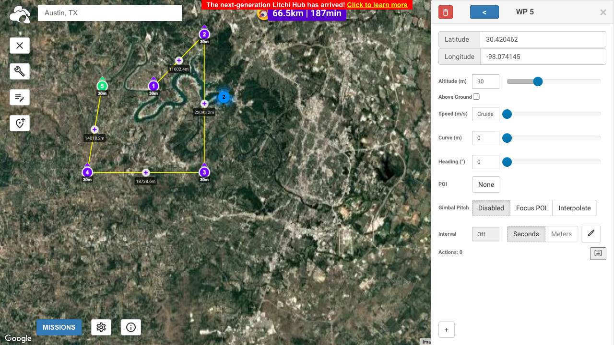

# flight-planner-playwright-tests

[](https://github.com/mattj3/flight-planner-playwright-tests/actions/workflows/playwright.yml)

End-to-end tests for [Litchi Hub](https://flylitchi.com/hub), a browser-based drone mission planner, written in **Playwright + TypeScript** with a page object, real value assertions and CI that keeps traces of every failure.

```bash
npm ci
npx playwright install chromium
npm test
```

## What this demonstrates

- **Page Object Model.** Every locator lives in [`pages/litchi-hub.page.ts`](pages/litchi-hub.page.ts); specs read as user steps.
- **Assertions on values, not presence.** Coordinates are parsed and checked against a bounding box around Austin, TX; the second of two waypoints must be north-west of the first; the mission distance must match a number-plus-unit pattern and be greater than zero.
- **Auto-retrying assertions** (`toBeVisible`, `toHaveValue`, `toHaveText`) instead of `isVisible()` + `toBeTruthy()`.
- **Reproducible randomness.** The random flight path uses a seeded generator; the seed is in the test title and can be overridden with `FLIGHT_SEED=123 npm test`.
- **Flake policy for a live third-party site.** Tests that depend on the geocoder or map tiles are tagged `@external` and retried twice in CI only; page-load checks are never retried.
- **CI with evidence.** GitHub Actions runs lint, format check, typecheck and the suite on every push and PR, plus weekly. The HTML report, with traces, screenshots and video of any failure, is uploaded as an artifact.

## Sample run

A random five-waypoint mission planned by `random-flight-path.spec.ts`:



## Tests

| Spec                             | Checks                                                                                      |
| -------------------------------- | ------------------------------------------------------------------------------------------- |
| `has-logo.spec.ts`               | The planner loads and shows its logo                                                        |
| `atx-search.spec.ts`             | Searching "Austin, TX" moves the map to Austin (a centre click lands inside the Austin box) |
| `add-waypoint.spec.ts`           | Clicking the map fills in finite, in-range latitude and longitude                           |
| `add-multiple-waypoints.spec.ts` | A second waypoint up and left of the first has a higher latitude and lower longitude        |
| `random-flight-path.spec.ts`     | Five seeded random waypoints produce a positive total distance                              |
| `prng.spec.ts`                   | Offline: the seeded generator is deterministic and stays in [0, 1)                          |

## Scripts

| Command                                                       | What it does                                                    |
| ------------------------------------------------------------- | --------------------------------------------------------------- |
| `npm test`                                                    | Run the whole suite headless                                    |
| `npm run test:headed`                                         | Watch it run (`SLOWMO=500 npm run test:headed` to slow it down) |
| `npm run test:ui`                                             | Playwright UI mode                                              |
| `npm run report`                                              | Open the last HTML report                                       |
| `npm run lint` / `npm run typecheck` / `npm run format:check` | Static checks run in CI                                         |

Run one spec with `npx playwright test add-waypoint`, or only the offline checks with `npx playwright test --project=chromium`.

## Project layout

```
flight-planner-playwright-tests/
├── .github/
│   ├── dependabot.yml
│   └── workflows/playwright.yml
├── pages/
│   └── litchi-hub.page.ts      # page object + seeded PRNG
├── tests/
│   ├── fixtures.ts             # Austin bounding box, distance pattern
│   ├── add-multiple-waypoints.spec.ts
│   ├── add-waypoint.spec.ts
│   ├── atx-search.spec.ts
│   ├── has-logo.spec.ts
│   ├── prng.spec.ts
│   └── random-flight-path.spec.ts
├── eslint.config.mjs
├── playwright.config.ts
├── tsconfig.json
└── package.json
```

## When the live site changes

This suite tests a site it does not own, so a red run can mean Litchi changed its page rather than a regression. Open the failing test's trace from the `playwright-report` artifact, compare the locator in `pages/litchi-hub.page.ts` with the live DOM, and update the locator there. Specs should not need to change.

## Licence

[MIT](LICENSE)
